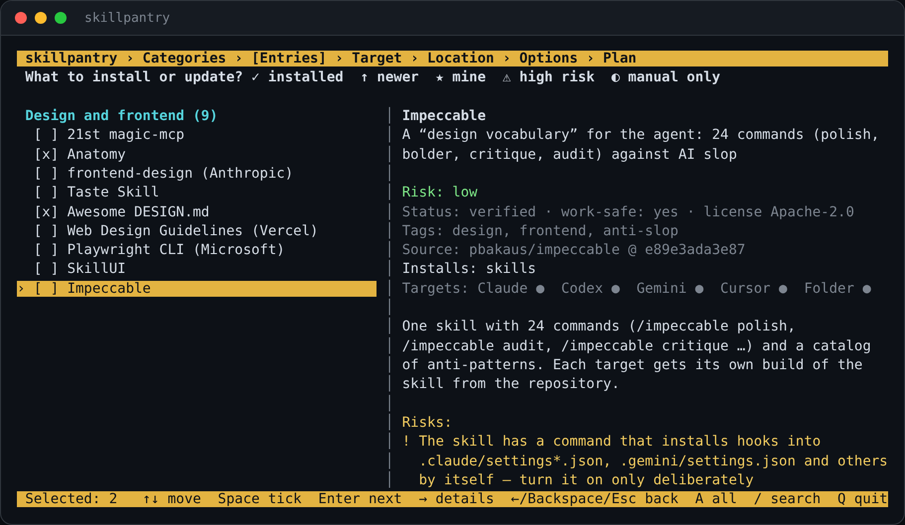

# skillpantry

**English** · [Русский](README.ru.md)

**One terminal UI to pick reviewed AI-agent skills, rules and MCP servers — and install them into
Claude Code, Codex, Gemini CLI, Cursor or a plain folder.** Every entry is pinned to a commit,
audited before install and removable with one command.

[](https://github.com/Dakirchik/skillpantry/actions/workflows/ci.yml)
[](LICENSE)




## Why

Skills, rules and MCP servers turn up in threads, reels and "awesome" lists. Every agent keeps them in
its own folders and formats, and installing someone else's instructions from a link is how you end up
with a hook you never read.

- **One catalog, any agent.** The same entry lands in `.claude/skills`, `.agents/skills`,
  `.gemini/skills` or `.cursor/skills`; rules become a managed block in `CLAUDE.md` / `AGENTS.md` /
  `GEMINI.md` or a Cursor `.mdc`; MCP servers go into `.mcp.json`, `config.toml` or `settings.json`.
- **Reviewed, not just collected.** 44 entries, each with a summary, risk level, risk notes, license and
  per-agent support. Installs come from a pinned commit, never from "latest".
- **Nothing to regret.** A static audit runs before every install, nothing from a source repository is
  executed, secrets are stored only as `${VAR}` references, and `uninstall` puts your project back
  byte for byte.

## Features

- **Full-screen wizard**: categories → entries → agent → project / global / folder → options → plan.
  A details panel follows the cursor; `/` searches; already installed entries are updated in place.
- **Agents**: Claude Code, Codex, Gemini CLI, Cursor, or a plain folder you wire up yourself.
- **Your own entries**: add a folder from your computer or any GitHub repo through a form — your own
  categories and tags, skills/rules/MCP detected for you. Kept apart from the shared catalog.
- **Updates**: see what is installed where, what changed upstream, update or remove in one go.
- **English and Russian** everywhere — UI, installers and every catalog text.
- **Zero dependencies**: Python 3.11+ standard library and Git. Windows consoles via `msvcrt`
  (Windows 10+, Windows Terminal), macOS and Linux via `termios`; a plain text menu everywhere else.
- **Obsidian export** of the whole catalog as one note.

## Install

**Windows** — download the repository and double-click `install.cmd`, or in PowerShell:

```powershell
git clone https://github.com/Dakirchik/skillpantry; cd skillpantry
.\pantryctl.ps1 install           # installs Python and Git via winget if they are missing
```

**macOS / Linux:**

```bash
git clone https://github.com/Dakirchik/skillpantry && cd skillpantry
./install.sh                      # -y, --library DIR, --python PATH, --lang en|ru
```

On macOS you can also double-click `install.command`. The installer creates the `skillpantry`,
`pantry` and `pantryctl` commands and puts them on PATH. No venv, no pip: the commands run Python
straight on the source folder, so `git pull` (or `pantryctl update`) is the whole update.
Manage the installation with `pantryctl status | update | paths | config | uninstall [--purge]`.

## Quick start

```bash
skillpantry                                   # full-screen UI
skillpantry list -t claude-code               # what works for one agent
skillpantry show context7                     # details (id or number)
skillpantry install context7 karpathy-skills -t claude-code       # into the current project
skillpantry install frontend-design -t codex -g                    # user-wide
skillpantry install anatomy -t folder -d ~/my-skills               # a plain folder
skillpantry install agent-skills-addy -t gemini --dry-run          # show the plan only
skillpantry status
skillpantry uninstall context7 -t claude-code
```

## What's in the catalog

| Category | Examples |
|---|---|
| Development and process | Superpowers, agent-skills (Addy Osmani), Karpathy rules, claudex-loop |
| Design and frontend | frontend-design (Anthropic), Impeccable, Taste Skill, Awesome DESIGN.md, 21st magic-mcp |
| Docs and code understanding | Context7, Graphify, Understand Anything |
| Tokens, models and memory | RTK, Headroom, OmniRoute, claude-mem |
| Web, data and backend | Supabase, API Anything, Agent Reach |
| Product, business and career | founder-skill, career-ops, replica-skill, MiroFish |
| Content, media and SEO | Search Console MCP, OpenSEO, real-sfx |
| Security and research | Strix, rea, geo-sleuth |

`skillpantry list` shows all 44. Plugins with hooks or background workers, global CLIs and OAuth flows
are never run for you — skillpantry prints the exact manual steps instead.

## Where things go

| Agent | Skills | Rules | MCP |
|---|---|---|---|
| `claude-code` | `.claude/skills/` | managed block in `CLAUDE.md` | `.mcp.json` (user scope: prints `claude mcp add`) |
| `codex` | `.agents/skills/` | managed block in `AGENTS.md` | `.codex/config.toml` |
| `gemini` | `.gemini/skills/` | managed block in `GEMINI.md` | `.gemini/settings.json` |
| `cursor` | `.cursor/skills/` | `.cursor/rules/<id>.mdc` | `.cursor/mcp.json` |
| `folder` | `<dir>/<id>/skills/` | `RULES.md` | `mcp.json` + `SKILLPANTRY.md` |

`-g` installs into your home folder for every project.

## Safety model

- Every entry pins a full commit SHA; only the needed paths are fetched and the commit is verified.
- New and bumped entries are `draft` until a human review (`skillpantry approve`), see [CONTRIBUTING.md](CONTRIBUTING.md).
- The install plan shows audit findings (pipe-to-shell, hidden-instruction phrasing, credential reads,
  obfuscation, package installs, config edits). Full list: `skillpantry audit <id> --all`.
- Installing only copies files and edits configs; nothing from the source repo is executed.
- Secrets are written as variable references only (`${VAR}`, `${env:VAR}`, `env_vars`).
- High-risk entries require typing the entry id (or `--accept-risk`).
- Foreign files are never overwritten without `--force`, which backs them up to `~/.skillpantry/backups`.
- Every change is journaled in `~/.skillpantry/installs.json`; `uninstall` restores the project exactly
  (covered by tests on Windows, macOS and Linux).

The audit is pattern matching that points a reviewer at lines worth reading — not a guarantee.
Found something unsafe in the catalog? See [SECURITY.md](SECURITY.md).

## Sync skills between agents

Choose **Sync skills between agents** in either menu (the full-screen menu opens a text wizard),
or run:

```sh
skillpantry sync --from claude-code --from-global -t codex -g --dry-run
skillpantry sync --from claude-code --from-global -t codex -g -y
skillpantry sync --from cursor --from-path ./source -t gemini -p ./destination --skill my-skill --force -y
```

This is an explicit one-way sync of installed skill folders, including skills not installed by
skillpantry. New skills are copied, identical folders skipped, and different folders blocked unless
`--force` is supplied. Replacements back up the entire previous folder under
`~/.skillpantry/backups/sync-*/`; copy failures roll back the current operation. Destination-only
skills remain untouched. Repeat `--skill` to select multiple skills.

The full SKILL.md folder travels with scripts, references, assets and templates. Contents and
relative paths remain unchanged; service directories such as `.git` and `node_modules` are excluded.
The destination folder uses a valid SKILL.md `name`, falling back to the source folder name.
Codex sources include `.agents/skills` and `.codex/skills`; the destination is `.agents/skills`.
Duplicate names are blocked. Source folder links are supported; nested links require manual review.
Destination links are blocked.

Agent-specific references produce warnings, without rewriting documents. External dependencies,
rules, MCP, settings and hooks must be handled separately. Sync does not create catalog or install
records; subsequent runs compare the actual folders. There is no background watcher.

## Your own entries

Home → **Add your own**: point at a folder or file on your computer (your own skill, a rules file, a
project with `.mcp.json`) or a GitHub repo. skillpantry shows what it found and an audit, then a form:
name, id, category (existing or a new one with its own description), tags (existing or new), summary,
description, what to install, risk, work-safe. GitHub entries stay drafts until you tick "reviewed by
me". Own entries live in `~/.skillpantry/catalog/`, so updates never touch them; local folders are used
in place, and a content hash tells you when they changed.

```bash
skillpantry add ~/skills/go-review                          # a folder with SKILL.md
skillpantry add ~/notes/team-rules.md --category work --category-title "Work" --tags team,go
skillpantry add https://github.com/owner/repo --mine        # a repo, for you only (draft)
skillpantry drop go-review                                  # remove your entry from the catalog
```

## Language

English or Russian, for the interface, the installers and the catalog texts. It follows the system
language by default; switch on the home screen (**Language / Язык**), with `skillpantry lang en|ru|auto`
(saved in `~/.skillpantry/config.toml`), for one run with `--lang en` or `SKILLPANTRY_LANG=en`, or at
install time with `pantryctl install --lang en` (`-Lang en` on Windows).

## Contributing

New entries are welcome — open an issue with the "New catalog entry" template, or a PR:

```bash
skillpantry add https://github.com/owner/repo   # draft manifest + audit
skillpantry validate
skillpantry audit <id> --all
skillpantry approve <id>                        # after the review checklist
```

Review checklist and rules: [CONTRIBUTING.md](CONTRIBUTING.md). Manifest schema:
[docs/manifest.md](docs/manifest.md). Shared entries carry English texts in `summary_en`,
`description_en`, `risk_notes_en` and `manual_en`; a test checks they are there.
Run the tests with `python -m pytest`.

## FAQ

**Will the agent actually use a skill that is just a folder?** Yes — a folder with `SKILL.md` is the
native format. Agents read each skill's `name` and `description` at startup and open the full file when
a task matches. Start a new session after installing.

**Does skillpantry use AI to review repositories?** No. It is deterministic: git, file detection and
pattern matching. The catalog texts were written by a person (with an AI assistant) and are stored in
the manifests.

**Upgrading from skillshelf?** That was this project's name before 0.5.0. Run the installer again: it
moves `~/.skillshelf` to `~/.skillpantry`, replaces the old commands and keeps everything you installed
manageable.

## License

[MIT](LICENSE). Catalogued skills and plugins belong to their authors under their own licenses, listed
per entry.
