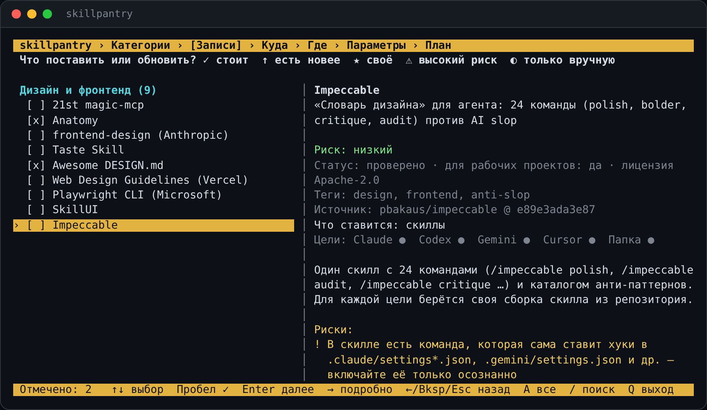

# skillpantry

[English](README.md) · **Русский**

**Один терминальный интерфейс, чтобы выбрать проверенные скиллы, правила и MCP-серверы для ИИ-агентов
и поставить их в Claude Code, Codex, Gemini CLI, Cursor или просто в папку.** Каждая запись закреплена
на коммите, проходит аудит перед установкой и удаляется одной командой.

[](https://github.com/Dakirchik/skillpantry/actions/workflows/ci.yml)
[](LICENSE)




## Зачем

Скиллы, правила и MCP находятся в рилсах и подборках, у каждого ИИ — свои папки и форматы, а
ставить чужие инструкции «по ссылке» небезопасно. skillpantry решает три вещи:

1. **Один каталог** — 44 записи с описанием, риском и поддержкой по целям; новые добавляются по правилам.
2. **Один установщик под разные ИИ** — те же скиллы в `.claude/skills`, `.agents/skills`, `.gemini/skills`,
   `.cursor/skills`; правила блоком в `CLAUDE.md` / `AGENTS.md` / `GEMINI.md` или `.mdc`; MCP — в
   `.mcp.json`, `config.toml`, `settings.json`, `mcp.json`.
3. **Безопасность по умолчанию** — закреплённые коммиты, ревью перед `verified`, аудит перед установкой,
   секреты только ссылками, подтверждение для записей высокого риска, ничего не запускается при установке.

## Установка

Логика — Python-пакет `skillpantry`, а за систему отвечает родной для каждой ОС скрипт `pantryctl`. Он находит Python 3.11+ и Git (и предлагает поставить, если их нет), создаёт
команды `skillpantry`, `pantry` и `pantryctl`, добавляет их в PATH, пишет `~/.skillpantry/config.toml`
и проверяет каталог. Зависимостей нет, отдельное окружение и pip не нужны: команды запускают
Python прямо на папке с исходниками, поэтому каталог, который вы правите, — это ваш git-репозиторий.

**Windows** — двойной щелчок по `install.cmd` или в PowerShell:

```powershell
git clone https://github.com/Dakirchik/skillpantry; cd skillpantry
.\pantryctl.ps1 install                      # Python и Git через winget, если их нет
.\pantryctl.ps1 install -Library D:\Skills    # своя папка для -t folder
```

**macOS / Linux:**

```bash
git clone https://github.com/Dakirchik/skillpantry && cd skillpantry
./install.sh                                # = ./pantryctl.sh install
./install.sh --library ~/Skills -y
```

На macOS можно дважды щёлкнуть `install.command` в Finder. Python ставится через Homebrew,
на Linux — через apt, dnf, pacman, zypper или apk (скрипт покажет команду и спросит). Старый Python
в системе? Укажите другой: `--python /opt/homebrew/bin/python3.12`.

Управление установкой одинаковое везде:

```
pantryctl status              что установлено, где, какие записи стоят в проектах
pantryctl update              git pull исходников, пересоздать команды, проверить каталог
pantryctl paths | config      пути / открыть config.toml
pantryctl uninstall [--purge] убрать команды и PATH; --purge — ещё журнал, кэш и config.toml
```

На Windows флаги пишутся как в PowerShell: `-Yes`, `-NoPath`, `-Purge`, `-Library`, `-Python`.
`uninstall` никогда не трогает файлы, поставленные в проекты, — их убирает `skillpantry uninstall`.
За корпоративным прокси сначала задайте `HTTPS_PROXY`: Git берёт его оттуда.

Без установки, из папки репозитория: `python -m skillpantry`.

## Интерфейс

`skillpantry` без аргументов открывает полноэкранный интерфейс — стрелки, чекбоксы и панель
описания, которая следует за курсором:

1. **Категории** — 9 направлений (разработка, дизайн и фронтенд, документация и понимание кода,
   токены и модели, веб и данные, продукт, контент и SEO, безопасность, скиллы для скиллов);
   на фокусе видно, что входит в направление.
2. **Записи** из выбранных категорий — описание, риск, источник, куда ставится, где уже стоит.
3. **Куда** — Claude Code, Codex, Gemini CLI, Cursor или папка; видно, сколько выбранного подходит.
4. **Где** — этот проект, другой проект, глобально (или папка-библиотека).
5. **Параметры** — подтверждение рисков, дополнительные скиллы, выбор файла (например, DESIGN.md
   с превью).
6. **План** — изменения и аудит на обычном экране, подтверждение; уже стоящее обновляется.

Ещё в главном меню: **Каталог** (просмотр, поиск, установка одной записи), **Установленное**
(где что стоит, что устарело, обновить или удалить отмеченное) и **Добавить своё** — см. ниже.

Клавиши: `↑↓` выбор · `Пробел` отметить · `A` все · `/` поиск · `Enter` далее · `?` подробно ·
`Esc` назад · `Q` выход. Работает в Windows Terminal, обычной консоли Windows 10+, Cmder, терминале
VS Code, Terminal и iTerm2 на macOS, любом терминале Linux — без сторонних библиотек. Там, где
полноэкранный режим недоступен (вывод в pipe, `TERM=dumb`, консоль старше Windows 10), включается
простое текстовое меню; принудительно — `skillpantry --plain` или `SKILLPANTRY_PLAIN=1`.

## Язык

Русский или английский — интерфейс, скрипты `pantryctl` и тексты каталога. По умолчанию — как в
системе; переключить: на главном экране **Language / Язык** или `skillpantry lang ru|en|auto`
(сохраняется как `language` в `~/.skillpantry/config.toml`). На один запуск: `skillpantry --lang en …`
или `SKILLPANTRY_LANG=en`. При установке: `pantryctl install --lang ru` (`-Lang ru` в Windows).

## Свои записи

Свой скилл, набор правил или MCP можно добавить в каталог формой — без правки TOML:

1. Главное меню → **Добавить своё** → **папка или файл на компьютере** либо **ссылка на GitHub**.
   Папку можно перетащить в окно терминала — путь вставится сам.
2. skillpantry смотрит, что внутри: `SKILL.md` (один скилл или папка скиллов), файл правил
   (`CLAUDE.md`, `AGENTS.md`, любой `.md`, если указать сам файл), `.mcp.json`, slash-команды —
   и показывает аудит.
3. Форма: **название** (из `SKILL.md` или имени папки), **id**, **категория** — существующая или
   **новая** со своим названием и описанием, **теги** — существующие или новые, **кратко**,
   **описание**, **что ставить** (отметить найденное), **риск**, **для рабочих проектов**.
   Для GitHub — ещё **«Проверено мной»**: без отметки запись — черновик и не ставится.
4. **Сохранить** или **Сохранить и установить** — сразу открывается мастер с этой записью.

Свои записи помечены `★`, их можно **изменить** и **удалить из каталога** в Каталоге (сама папка
не трогается). Хранятся отдельно — в `~/.skillpantry/catalog/` (там же `_categories.toml` со своими
категориями), поэтому `pantryctl update` их не затирает, а `pantryctl uninstall --purge` спрашивает
отдельно и с `-y` не удаляет никогда.

Файлы из своей папки ставятся как есть; версия — хэш содержимого. Поменяли файлы — в списках
появится `↑ папка изменилась`, и установки обновляются из «Установленного» или повторным `install`.

То же из командной строки:

```powershell
skillpantry add D:\skills\go-review                         # папка со SKILL.md → своя запись
skillpantry add ~/notes/team-rules.md --category work --category-title "Работа" --tags team,go
skillpantry add https://github.com/owner/repo --mine        # GitHub → свой каталог (черновик)
skillpantry approve repo                                    # после просмотра — можно ставить
skillpantry drop go-review                                  # убрать свою запись из каталога
```

## Быстрый старт

```powershell
# Полноэкранный интерфейс
skillpantry

# Посмотреть каталог для конкретного ИИ
skillpantry list -t claude-code
skillpantry list --work            # только безопасные для рабочих проектов
skillpantry show 4                 # подробно (по номеру или id)

# Поставить в текущий проект
skillpantry install context7 karpathy-skills -t claude-code
skillpantry install context7 -t cursor -p D:\work\lk-front     # в другой проект
skillpantry install frontend-design -t claude-code -g          # глобально
skillpantry install anatomy awesome-design-md -t folder --variant stripe   # в ~/skillpantry-library

# Посмотреть план, ничего не меняя
skillpantry install agent-skills-addy -t codex --dry-run

# Что стоит и удалить
skillpantry status
skillpantry uninstall context7 -t claude-code
```

## Цели

| Цель | Скиллы | Правила | MCP |
|---|---|---|---|
| `claude-code` | `.claude/skills/` | блок в `CLAUDE.md` | `.mcp.json` (глобально — команда `claude mcp add`) |
| `codex` | `.agents/skills/` | блок в `AGENTS.md` | `.codex/config.toml` |
| `gemini` | `.gemini/skills/` | блок в `GEMINI.md` | `.gemini/settings.json` |
| `cursor` | `.cursor/skills/` | `.cursor/rules/<id>.mdc` | `.cursor/mcp.json` |
| `folder` | `<папка>/<id>/skills/` | `RULES.md` | `mcp.json` + `SKILLPANTRY.md` с источником и шагами |

`-g` ставит в домашнюю папку (для всех проектов), `-p` — в указанный проект, по умолчанию — текущая папка.
Для `folder` папка задаётся `-d` (по умолчанию `~/skillpantry-library`, или `$SKILLPANTRY_LIBRARY`).

Плагины с хуками и фоновыми процессами (claude-mem, Understand-Anything, ECC, полные версии
Ponytail и Superpowers), глобальные CLI (RTK, Headroom, graphify, Strix) и OAuth skillpantry сам
**не ставит**: печатает точные команды в «Ручных шагах».

## Как устроена безопасность

- **Закреплённый коммит.** Каждая запись указывает полный SHA; скачивается ровно он (sparse-checkout
  только нужных путей) и сверяется после загрузки.
- **Ревью перед `verified`.** Новые записи и записи после обновления — `draft`, ставятся только с
  `--allow-draft`. Чек-лист — в [CONTRIBUTING.md](CONTRIBUTING.md).
- **Аудит перед установкой.** В плане видно число скриптов и находок (`curl | sh`, просьбы скрывать
  действия, чтение ключей, обфускация, установка пакетов, правка конфигов). Подробно: `skillpantry audit <id> --all`.
- **Ничего не запускается.** Установка — это копирование файлов и правка конфигов; `npm`, `pip`,
  скрипты из репозиториев не выполняются.
- **Секреты только ссылками.** В конфиги MCP пишутся `${VAR}` / `${env:VAR}` / `env_vars`, значения — никогда.
- **Высокий риск — с подтверждением.** Нужно ввести id записи (или `--accept-risk`).
- **Записи не перетирают друг друга.** Если два набора ставят скилл с одним именем (сейчас так у agent-skills и Superpowers: `test-driven-development`), установка останавливается и предлагает `--skip-skill`.
- **Чужие файлы не трогаются.** Если папка скилла или MCP-сервер с тем же именем уже есть и не от
  skillpantry — установка останавливается; `--force` заменяет с резервной копией в `~/.skillpantry/backups`.
- **Полный откат.** Каждое изменение записано в `~/.skillpantry/installs.json`; `uninstall` возвращает
  файлы проекта к исходному виду (проверяется тестами).
- **`work_safe`.** Записи, которые отправляют данные третьим лицам, помечены и подсвечиваются при установке
  в проект: для рабочего кода согласуйте с ИБ.

## Каталог

`skillpantry list` или заметка для Obsidian: `skillpantry export-md -o <vault>/AI-skills-catalog.md`.
Манифесты — источник правды, заметка пересобирается из них.

Особые случаи в текущем каталоге:

- **watermarks-remover** — `excluded`: инструмент удаляет маркировку ИИ-контента (C2PA, скрытые водяные знаки).
- **Instagram- и YouTube-скиллы, Fish Audio, Openverse** — `reference`: публичного репозитория нет или это API.
- **career-ops** ставится только как рабочая папка (`-t folder`): скилл ссылается на файлы в корне репозитория.
- **real-sfx** — в репозитории нет лицензии, это отмечено в рисках.

## Пополнение каталога

```powershell
skillpantry add https://github.com/owner/repo   # черновик манифеста + аудит
skillpantry validate
skillpantry audit <id> --all
skillpantry approve <id>                        # после ревью по чек-листу

skillpantry outdated                            # что обновилось в источниках
skillpantry bump <id> --diff                    # новый коммит → draft → ревью → approve
```

Правила и чек-лист — [CONTRIBUTING.md](CONTRIBUTING.md), схема манифеста — [docs/manifest.md](docs/manifest.md).

## Все команды

| Команда | Что делает |
|---|---|
| `skillpantry` | интерактивное меню |
| `list [-t цель] [--work] [--status s] [--category c]` | список |
| `show <id…>` / `search <текст>` | подробности / поиск |
| `install <id…> -t цель [-g \| -p путь \| -d папка]` | установка; `--dry-run`, `-y`, `--skill`, `--skip-skill`, `--optional`, `--variant`, `--force`, `--accept-risk` |
| `uninstall <id…> -t цель [...]` | удалить поставленное skillpantry |
| `status [--all] [-v]` | что установлено |
| `fetch <id…> \| --all` | скачать заранее (потом работает офлайн) |
| `audit <id> [--all]` | статический аудит |
| `add <папка\|файл\|url> [--mine]` / `drop <id>` | своя запись из папки или GitHub / удалить её из каталога |
| `add <url>` / `validate` / `approve <id>` | пополнение общего каталога |
| `outdated` / `bump <id> [--diff]` | обновления |
| `export-md [-o путь]` | каталог в Markdown для Obsidian |
| `lang [en\|ru\|auto]` | язык интерфейса: показать или сохранить |
| `cache-clear [id]` / `doctor` | обслуживание |

Настройки: `~/.skillpantry/config.toml` (`library`, `catalog`, `user_catalog`) или переменные окружения, которые
важнее файла: `SKILLPANTRY_HOME` (данные, по умолчанию `~/.skillpantry`), `SKILLPANTRY_CATALOG`,
`SKILLPANTRY_USER_CATALOG` (свои записи, по умолчанию `~/.skillpantry/catalog`),
`SKILLPANTRY_LIBRARY`, `NO_COLOR`. Для pantryctl: `SKILLPANTRY_APPDIR`, `SKILLPANTRY_BINDIR`.

## Разработка

```bash
pip install pytest
python -m pytest -q
```

Тесты не ходят в сеть: поднимают локальный git-репозиторий вместо GitHub. CI (GitHub Actions)
гоняет их на Windows, macOS и Ubuntu с Python 3.11 и 3.13, а также по-настоящему ставит, использует
и удаляет skillpantry через `pantryctl.ps1` (Windows PowerShell 5.1 и PowerShell 7) и `pantryctl.sh`.

## Вопросы

**ИИ поймёт скилл, если это просто папка?** Да — папка со `SKILL.md` и есть родной формат. Агент при
старте читает `name` и `description` каждого скилла и открывает файл целиком, когда задача подходит.
После установки начните новую сессию.

**Внутри есть ИИ, который проверяет репозитории?** Нет: git, поиск файлов по именам и аудит по шаблонам.
Тексты каталога написаны человеком (с ИИ-ассистентом) и лежат в манифестах.

**Обновляетесь со skillshelf?** Так проект назывался до 0.5.0. Запустите установку ещё раз: она
перенесёт `~/.skillshelf` в `~/.skillpantry`, заменит старые команды, и всё поставленное раньше
останется под управлением.

## Лицензия

MIT. Скиллы и плагины в каталоге принадлежат их авторам и распространяются по своим лицензиям
(указаны в каждой записи).
